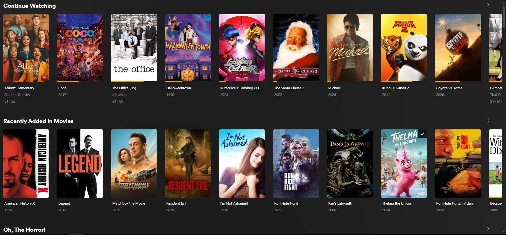
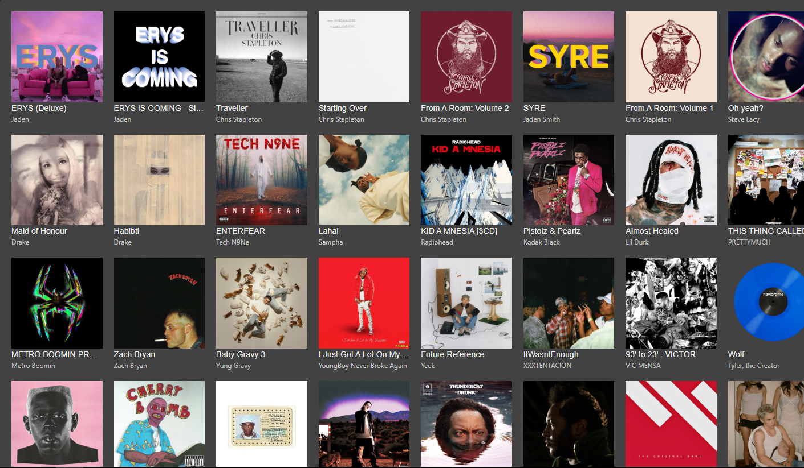
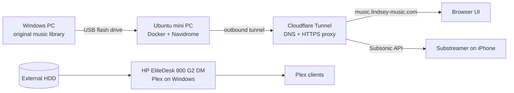

# Homelab Media Servers: Plex + Navidrome

Two self-hosted media servers I built and maintain: a **Plex Media Server** for movies and TV, and a **Navidrome music server** running in Docker on Ubuntu Linux, reachable from my phone anywhere. This repo documents the hardware, architecture, and lessons learned.

> Built as a hands-on way to learn Linux, Docker, networking, and file sharing, and because I love music and movies.

## Screenshots

| Plex | Navidrome |
|------|-----------|
|  |  |

## At a Glance

| | Plex Media Server | Navidrome Music Server |
|---|---|---|
| **Hardware** | HP EliteDesk 800 G2 DM (Intel Core i5-6600T, 24 GB RAM, SSD boot drive) | Mini PC (originally bought for gaming, repurposed) |
| **OS** | Windows | Ubuntu Linux |
| **Runs as** | Native Windows install | Docker container |
| **Storage** | External HDD | Local music folder on the server, loaded from a USB flash drive |
| **Remote access** | TODO (Plex remote access?) | Cloudflare Tunnel with a custom domain (HTTPS) |
| **Clients** | Plex apps on supported devices | Browser UI + Substreamer (iPhone) |

## Architecture



## Navidrome Music Server

**Goal:** an always-on, self-hosted streaming service for my personal music library, usable from my phone on the go.

**What I did**
- Installed Ubuntu Linux on a mini PC and set it up as a headless, always-on server.
- Deployed Navidrome with Docker Compose (see below).
- Loaded my music library onto the server from my Windows PC using a USB flash drive, after Samba file sharing between the two machines gave me trouble. TODO: one line on what went wrong with Samba.
- Registered a **custom domain** and manage its DNS through **Cloudflare**. A **Cloudflare Tunnel** connects the server to Cloudflare with an outbound-only connection, so the Navidrome web UI is reachable at `music.lindsey-music.com` over HTTPS **without opening any ports on my home router** or exposing my home IP address.
- Connected the **Substreamer** iOS app through Navidrome's Subsonic-compatible API.

### `docker-compose.yml`

```yaml
services:
  navidrome:
    image: deluan/navidrome:latest
    container_name: navidrome
    restart: unless-stopped
    ports:
      - "4533:4533"
    environment:
      ND_SCANSCHEDULE: 1h        # rescan the library hourly
      ND_LOGLEVEL: info
      ND_SESSIONTIMEOUT: 24h
      ND_BASEURL: ""
    volumes:
      - ./data:/data             # Navidrome's database, settings, playlists, cache
      - ~/Music:/music:ro        # music library, mounted read-only
```

Navidrome's own state lives in `./data` on the host, so accounts, playlists, and settings survive container restarts and updates. The music library is mounted **read-only**, so Navidrome can never modify my files.

## Plex Media Server

**Goal:** centralize my movies and shows and stream them to any supported device.

**What I did**
- Upgraded an HP EliteDesk 800 G2 DM small form factor PC myself: RAM from the original 8 GB to 24 GB, and the boot drive from an HDD to an SSD.
- Installed Plex Media Server natively on Windows and run it on that machine.
- Stored the media library on an external HDD.
- Organized libraries so Plex matches artwork and metadata correctly (TODO: naming convention, e.g. `Movies/Title (Year)/`).
- TODO: transcoding, remote access, user sharing, or other settings you configured.

## What I Learned

> Edit these so they match what you actually experienced. This is the section interviewers care about most.

- **My first attempt failed, and the second worked.** I originally tried this setup and didn't get it running. I came back, worked through it one layer at a time (Docker, then file sharing, then Navidrome, then the phone app), and verified each step before moving on.
- **Know when to change approach.** I tried Samba file sharing between Windows and Ubuntu, ran into issues, and switched to a USB flash drive so the project kept moving. Network sync is on my roadmap to revisit.
- **Containers and data are separate.** Keeping Navidrome's database in a host folder means I can update or recreate the container without losing accounts or playlists.
- **A tunnel beats port forwarding.** Cloudflare Tunnel gave me HTTPS and a public hostname without exposing my home network.
- TODO: what you'd improve next.

## Maintenance

- **Updates:** TODO (e.g. `docker compose pull && docker compose up -d`, and how often)
- **Backups:** TODO (Navidrome `./data` folder, Plex database)
- **Monitoring:** TODO (or "none yet", which is also an honest answer)

## Roadmap

- [ ] Revisit Samba / network sync for the music library
- [ ] Automated backups
- [ ] Container update automation
- [ ] Cloudflare Access in front of the tunnel
- [ ] Uptime monitoring
- [ ] Network diagram

## Tech Used

Ubuntu Linux · Windows · Docker · Cloudflare (DNS + Tunnel) · Navidrome · Plex · Substreamer (Subsonic API)
